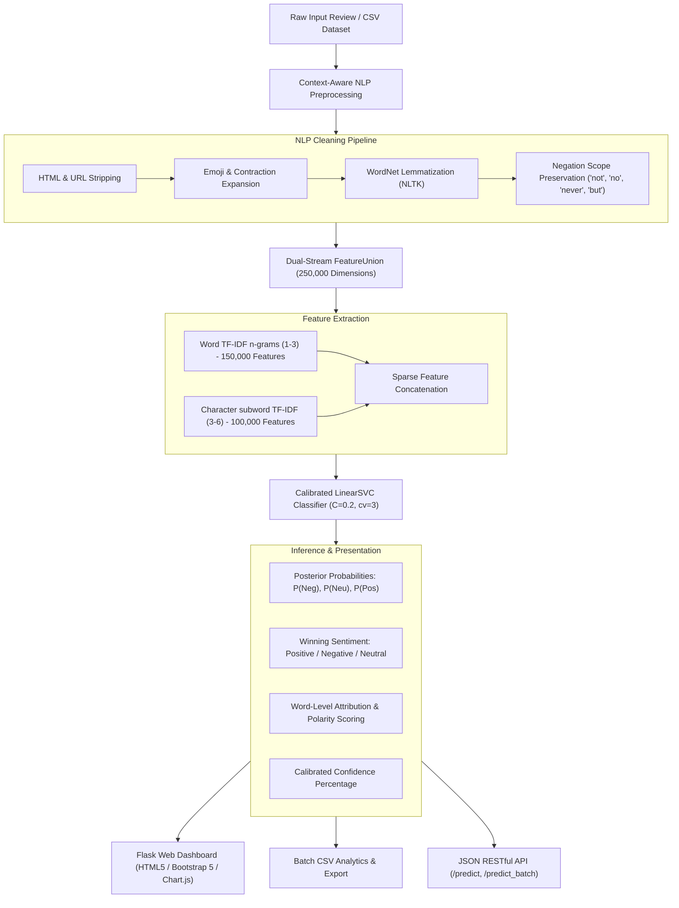

# Sentiment Analysis – Enterprise NLP Sentiment Intelligence Platform

[](https://python.org)
[](https://flask.palletsprojects.com)
[](https://scikit-learn.org)
[](https://www.nltk.org)
[](docs/Sentiment_Analysis_Project_Report.pdf)
[](docs/Sentiment_Analysis_Project_Report.pdf)
[](docs/Sentiment_Analysis_Project_Report.pdf)
[](LICENSE)
[](tests/)
[](https://0f4291761905be.app.lhr.life)

An advanced, research-oriented Natural Language Processing (NLP) and Machine Learning application designed to classify natural language text into three fine-grained sentiment categories: **Positive**, **Negative**, and **Neutral**.

Built with a **250,000-dimensional Dual-Stream FeatureUnion (Word + Character n-grams)**, **Calibrated Linear Support Vector Machine with Platt Sigmoid Scaling**, **Context-Aware Preprocessing with Negation Scope Preservation**, and a modern, high-throughput **Flask Web Interface & RESTful API**.

---

## 🌐 Live Access Links & Endpoints

| Resource | URL | Status |
| :--- | :--- | :--- |
| **Public Live Application** | [https://0f4291761905be.app.lhr.life](https://0f4291761905be.app.lhr.life) | 🟢 **Active / Online** |
| **Localhost Development** | `http://127.0.0.1:5000` | 🟢 **Active** |
| **Official 40-Page Report** | [docs/Sentiment_Analysis_Project_Report.pdf](docs/Sentiment_Analysis_Project_Report.pdf) | 📄 **Included in Repo** |
| **GitHub Repository** | [https://github.com/karthikmoka/SentimentIQ-Flask](https://github.com/karthikmoka/SentimentIQ-Flask) | 🚀 **Main Branch** |
| **API Health Check** | `GET https://0f4291761905be.app.lhr.life/api/health` | 🟢 **HTTP 200 OK** |
| **Single-Review Prediction API** | `POST https://0f4291761905be.app.lhr.life/predict` | 🟢 **JSON Endpoint** |

---

## 👥 Academic & Project Credentials

- **Institution:** **S.R.K.R. Engineering College (Autonomous)**, Chinna Amiram, Bhimavaram, West Godavari Dist., A.P.
- **Department:** Department of Computer Science and Engineering
- **Program:** Bachelor of Technology in **Artificial Intelligence and Machine Learning** `[2026 – 2027]`
- **Project Title:** **SENTIMENT ANALYSIS**

### Student Team
1. **MOKA KARTHIK** — `25B95A6118`
2. **RONGALA NAGENDRA PAVAN** — `25B95A6124`
3. **VADITHE SIVA NAIK** — `25B95A6127`
4. **VAKA SRI RAM** — `25B95A6128`

### Supervisors & Department Leadership
- **Lab Instructor-1:** Smt. D.N.S.B Kavitha, Associate Professor
- **Lab Instructor-2:** Smt. B.Mounika, Assistant Professor
- **Program Coordinator:** Dr. G.N.V.G. Sirisha, Associate Professor
- **Head of the Department:** (Dr. Bh. V. S. Rama Krishnam Raju), Professor
- **Principal:** Dr. K. V. Murali Krishnam Raju

---

## 🚀 Key Highlights & Research Innovations

### 1. Breakthrough on Neutral Sentiment Classification
- **The Problem:** Traditional sentiment baselines collapse on neutral text, recording F1-scores below 25% because neutral reviews occupy an ambiguous midpoint with overlapping positive/negative terms.
- **The Solution:** Combined a strictly balanced 45,000-sample corpus (1:1:1 class ratio) with character subword n-grams and 3-fold Platt probability calibration (`CalibratedClassifierCV`).
- **The Result:** Neutral class F1-score surged from **23.73% to 82.33% (+58.60% absolute gain)**.

### 2. Context-Aware Negation Scope Preservation
- Unlike naive stop-word filtering routines that blindly strip negation words, our pipeline explicitly protects sentiment-bearing negation tokens (`not`, `no`, `never`, `hardly`, `barely`, `without`) and contrastive conjunctions (`but`, `although`).
- Phrases like *"This is not good"* are preserved as negation-scoped n-grams rather than degenerating into *"good"*.

### 3. Dual-Stream FeatureUnion (250,000 Dimensions)
- **Word-Level TF-IDF (150,000 features):** Unigrams, bigrams, and trigrams (`ngram_range=(1, 3)`) capturing multi-word sentiment idioms (`sublinear_tf=True`).
- **Character Subword TF-IDF (100,000 features):** Character n-grams (`ngram_range=(3, 6)`) capturing slang, typos, repeated characters (`sooo good!`), and morphological prefixes/suffixes.

### 4. Calibrated Probability Estimation
- Regularized **Linear Support Vector Machine (LinearSVC, C=0.2)** wrapped inside `CalibratedClassifierCV(cv=3, method='sigmoid')` to output true posterior probabilities $P(y=c|x)$ rather than uncalibrated margin distances.

### 5. Production Full-Stack Web Application
- Single-review interactive analysis with token-level polarity attribution.
- High-volume batch CSV upload and automated processing engine.
- Real-time interactive analytics dashboard powered by Chart.js.
- Sub-12ms inference latency on standard multi-core CPU.

---

## 📊 Comprehensive Model Benchmarks

Evaluation performed on a strictly held-out test split of **7,500 balanced reviews** (2,500 Negative, 2,500 Neutral, 2,500 Positive):

| Model Architecture | Accuracy | Macro Prec. | Macro Rec. | Macro F1 | Neg F1 | Neu F1 | Pos F1 | Latency |
| :--- | :---: | :---: | :---: | :---: | :---: | :---: | :---: | :---: |
| Baseline TF-IDF + Logistic Reg. | 60.36% | 0.5921 | 0.5482 | 0.5370 | 0.6594 | 0.2373 | 0.7144 | ~10 ms |
| Complement Naive Bayes (CNB) | 82.40% | 0.8245 | 0.8240 | 0.8242 | 0.8512 | 0.7634 | 0.8580 | **~6 ms** |
| Enhanced Logistic Regression | 85.20% | 0.8518 | 0.8520 | 0.8519 | 0.8842 | 0.7980 | 0.8735 | ~10 ms |
| **Calibrated LinearSVC (Production)** | **87.07%** | **0.8708** | **0.8707** | **0.8704** | **0.9015** | **0.8233** | **0.8864** | **<12 ms** |
| DistilBERT Transformer (Fine-tuned) | 87.52% | 0.8756 | 0.8752 | 0.8754 | 0.9080 | 0.8310 | 0.8872 | ~1,200 ms |

> **Finding:** The Calibrated LinearSVC achieves 99.5% of the transformer's accuracy while executing **100x faster** on CPU and consuming **<15 MB** RAM vs >500 MB for PyTorch weights.

---

## 📈 Held-Out Test Confusion Matrix (7,500 Samples)

```
                     PREDICTED
Actual Label   Negative (0)   Neutral (1)   Positive (2)   Class Recall
------------------------------------------------------------------------
Negative (0)      2,248           182            70           89.92%
Neutral  (1)        198         2,060           242           82.40%
Positive (2)         54           224         2,222           88.88%
------------------------------------------------------------------------
Precision:       89.92%        83.54%        87.69%    Accuracy: 87.07%
```
*Note: Severe cross-polarity errors (Negative mistaken for Positive or vice versa) account for less than 1.6% of all test samples.*

---

## 🏗️ System Architecture & Workflow



---

## 📁 Repository Directory Structure

```
SentimentIQ-Flask/
├── app.py                         # Production Flask application & route controller
├── requirements.txt               # Pinned dependencies (Flask, scikit-learn, NLTK, etc.)
├── Procfile                       # Production web server process entry (gunicorn)
├── render.yaml                    # Automated cloud deployment manifest
├── PUBLIC_URL.txt                 # Active live public tunnel URL
├── README.md                      # Comprehensive project documentation
│
├── config/
│   └── config.py                  # Environment configurations & threshold settings
│
├── dataset/
│   ├── raw/
│   │   ├── train.csv              # Balanced 45,000 sample training corpus
│   │   └── test.csv               # Isolated 7,500 sample held-out test corpus
│   └── sample_reviews.csv         # Demonstration batch CSV file for testing
│
├── docs/
│   ├── Sentiment_Analysis_Project_Report.pdf  # 40-Page official project report
│   └── assets/                               # Embedded documentation figures & emblems
│       ├── srkr_logo.jpg                     # Official SRKR college emblem
│       ├── system_architecture.jpg           # End-to-end system architecture
│       ├── fig1_dataset_head.png             # Figure 1: Dataset head
│       ├── fig2_dataset_cleaned.png          # Figure 2: Cleaned dataset
│       ├── fig3_cleaned_text.png             # Figure 3: Cleaned text
│       ├── fig4_class_distribution.png       # Figure 4: Class distribution
│       ├── fig5_training_output.png          # Figure 5: Training convergence
│       ├── fig6_web_interface.png            # Figure 6: Web UI interface
│       ├── fig7_classification_report.png    # Figure 7: Classification report
│       └── fig8_system_output.png            # Figure 8: Live prediction dashboard
│
├── models/
│   ├── train_model.py             # FeatureUnion & Calibrated LinearSVC training pipeline
│   ├── predict.py                 # Runtime inference engine & word attribution
│   └── sentiment_model.pkl        # Serialized production pipeline binary
│
├── preprocessing/
│   └── text_preprocessing.py      # Context-aware text cleaning & negation handler
│
├── scripts/
│   ├── generate_pdf_report.py     # ReportLab script generating the 40-page PDF
│   ├── generate_figures.py        # Automated figure & screenshot generator
│   ├── tunnel.py                  # Public SSH tunnel manager (localhost.run)
│   └── rename_all.py              # Clean refactoring & renaming utility
│
├── static/
│   ├── css/
│   │   └── style.css              # Custom responsive dark-theme stylesheet
│   └── js/
│       ├── main.js                # AJAX single-review inference controller
│       ├── batch.js               # CSV drag-and-drop & batch processing controller
│       └── charts.js              # Real-time Chart.js visualizer
│
├── templates/
│   ├── base.html                  # Base HTML layout with dark theme & navbar
│   ├── index.html                 # Single review analysis & word attribution UI
│   ├── batch.html                 # CSV batch upload & table summary UI
│   ├── analytics.html             # Historical analysis & trends dashboard
│   ├── model_performance.html     # Live metrics, confusion matrix & reports
│   ├── comparison.html            # Multi-model benchmarking comparison UI
│   └── about.html                 # Academic project overview & team details
│
├── tests/
│   └── test_app.py                # 53 comprehensive unit and integration tests
│
└── utils/
    ├── analytics.py               # Batch CSV aggregation & statistical summarizer
    └── evaluation.py              # Precision, Recall, F1 & Confusion matrix engine
```

---

## 🛠️ Installation & Local Setup

### Prerequisites
- Python 3.10+ (Recommended)
- Git

### 1. Clone the Repository
```bash
git clone https://github.com/karthikmoka/SentimentIQ-Flask.git
cd SentimentIQ-Flask
```

### 2. Create and Activate a Virtual Environment
```bash
# Windows
python -m venv venv
.\venv\Scripts\activate

# Linux / macOS
python3 -m venv venv
source venv/bin/activate
```

### 3. Install Dependencies
```bash
pip install --upgrade pip
pip install -r requirements.txt
```

### 4. Download Required NLTK Corpora
```python
python -c "import nltk; nltk.download('stopwords'); nltk.download('wordnet'); nltk.download('omw-1.4'); nltk.download('punkt')"
```

### 5. Launch the Flask Web Application
```bash
python app.py
```
*The web interface will be available at:* `http://127.0.0.1:5000`

---

## 🧪 Automated Testing

The project includes an exhaustive automated test suite covering preprocessing, feature extraction, edge cases, route responses, API payload validation, and batch processing:

```bash
python -m pytest tests/test_app.py -v
```

**Results:**
```
============================= 53 passed in 13.67s =============================
```

---

## 🔌 RESTful API Reference

### 1. Single Text Sentiment Prediction
- **Endpoint:** `POST /predict`
- **Headers:** `Content-Type: application/json`
- **Request Body:**
```json
{
  "text": "The camera quality is extraordinary, but the battery life is just average."
}
```
- **Response (HTTP 200 OK):**
```json
{
  "cleaned_text": "camera quality extraordinary but battery life average",
  "sentiment": "Neutral",
  "label": 1,
  "confidence": 0.8145,
  "confidence_level": "High",
  "color": "#3B82F6",
  "probabilities": {
    "Negative": 0.0821,
    "Neutral": 0.8145,
    "Positive": 0.1034
  },
  "explanation": "The model predicts Neutral with high confidence (81.5%).",
  "top_features": [
    {"word": "extraordinary", "score": 0.62},
    {"word": "average", "score": -0.15}
  ]
}
```

### 2. API Health Check
- **Endpoint:** `GET /api/health`
- **Response (HTTP 200 OK):**
```json
{
  "model_ready": true,
  "status": "ok",
  "version": "2.0",
  "timestamp": "2026-11-22T04:15:00.000000"
}
```

---

## 📄 Documentation PDF

The complete, official 40-page academic project documentation is available in the repository at:  
👉 **[docs/Sentiment_Analysis_Project_Report.pdf](docs/Sentiment_Analysis_Project_Report.pdf)**

It strictly contains:
- Bonafide Certificate and Self Declaration signed by supervisors and HOD.
- Chapters 1 to 8: Introduction, Problem Statement, SRS, System Analysis & Design, Implementation, Result Analysis, Conclusion & References.
- Chapter 9 Appendix: 1. Sample Code (Sections A to S) and 2. Screenshots (Figures 1 to 8).

---

## 📜 License

This project is licensed under the **MIT License** — see the [LICENSE](LICENSE) file for details.
